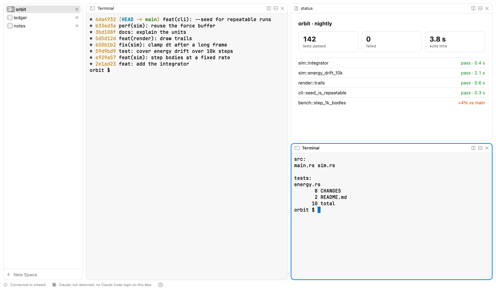

# Wheel

A native macOS and iOS workspace for running coding agents across projects. Each project is a **space**: a grid of panes holding terminals, agent chats, web views and browsers. A Rust daemon, `wheeld`, holds all of the state, so a terminal, an agent's conversation and a layout outlive the window that showed them, and a phone can attach to the same session.

<picture>
  <source media="(prefers-color-scheme: dark)" srcset="docs/screenshots/main-dark.png">
  
</picture>

## What it does

- **Spaces and panes.** One space per project folder, listed in the sidebar. Split any pane left, right, up or down, drag panes between spaces, and change what a pane shows from its header.
- **Terminals.** Real terminals rendered by [libghostty](https://ghostty.org), with shell integration for zsh and bash. They keep running in the daemon when the app closes.
- **Agent panes.** Claude Code, Codex and pi run in panes, either as their own terminal UI or as a native chat with a composer, tool calls and permission prompts. A pane switches between the two views of the same conversation.
- **Artifacts.** A web pane shows an artifact: an HTML page named by an entry in a project's `wheel.toml`. Pages reload when their files change, can keep data, and can ask the daemon to run a command the person approved. Built-in artifacts include a beads issue board, a Markdown renderer and a command runner.
- **A CLI for everything.** `wheel` drives the daemon over its socket: spaces, panes, terminals, agents, artifacts, settings and permissions. Agents inside Wheel use it to open panes and show their work; `wheel --skill` prints the guide they read.
- **iPhone.** The iOS app pairs with a Mac through a one-time code and shows the same spaces, terminals and agents over the network.

## How it fits together

```
 Mac app (SwiftUI) ─┐                         ┌─ PTYs and terminal screens (libghostty-vt)
 iOS app (SwiftUI) ─┼── WebSocket ── wheeld ──┼─ agent sessions (claude, codex, pi)
 wheel CLI ─────────┘                         ├─ spaces, layouts, settings
                                              └─ artifact server, permissions
```

The clients hold no state the daemon lacks; they render what it sends ([ADR-0001](docs/adr/0001-native-swift-clients-over-a-rust-daemon.md)). Wheel runs only what its app bundle carries, plus the agent programs you already have installed ([ADR-0013](docs/adr/0013-wheel-runs-only-what-it-ships-or-names.md)). The decisions behind the design are in [`docs/adr/`](docs/adr), and the project's vocabulary is in [`docs/CONTEXT.md`](docs/CONTEXT.md).

| Directory | What's in it |
| --- | --- |
| `daemon/` | `wheeld`, the Rust daemon |
| `cli/` | `wheel`, the command-line client |
| `apple/` | `WheelKit` and `WheelUI` Swift packages, the Mac app and the iOS app |
| `artifacts/` | Built-in artifacts the daemon embeds |
| `proto/` | The client–daemon protocol |
| `docs/` | Architecture decision records and the glossary |

## Requirements

- macOS 15 or later (the iOS app needs iOS 18)
- Xcode 16 and [XcodeGen](https://github.com/yonaskolb/XcodeGen)
- Rust (stable) and [mise](https://mise.jdx.dev), which installs Zig 0.16 the first time the terminal emulator builds
- Optional: `claude`, `codex` or `pi` on your PATH for agent panes. Wheel runs without them, and Settings › Agents shows which it found.

## Building

```sh
# The daemon and CLI. The first build downloads Ghostty's source and Zig packages.
cargo build

# The Mac app, which embeds wheeld.
xcodegen generate --spec apple/project.yml --project apple
xcodebuild -project apple/Wheel.xcodeproj -scheme Wheel -configuration Debug \
  -derivedDataPath DerivedData build
open DerivedData/Build/Products/Debug/Wheel.app
```

Run `target/debug/wheel status` to check that the CLI reaches the daemon.

## Testing

```sh
cargo test                                  # daemon and CLI
swift test --package-path apple/WheelKit    # shared Swift code
```

`.claude/skills/project/verify.md` describes the end-to-end checks, which drive a throwaway daemon and the real Mac app through the CLI and the app's debug server.

## Status

Wheel is in active development and has no release yet. The interface uses stock macOS styling until the core works end to end ([DESIGN.md](DESIGN.md)).

## License

[MIT](LICENSE)
