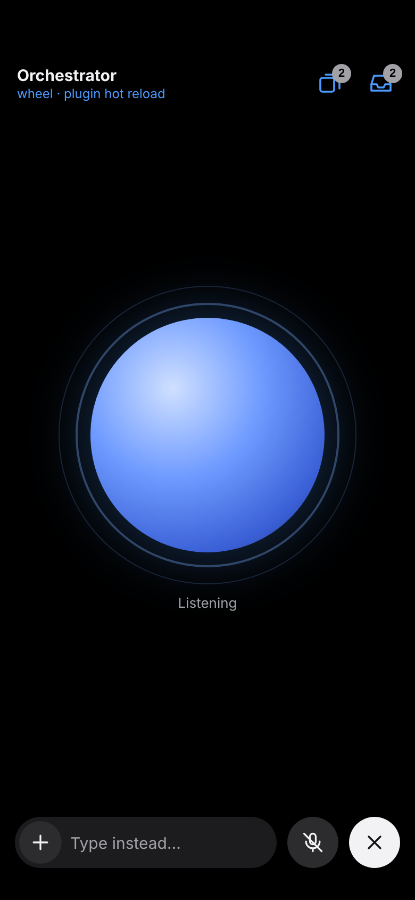
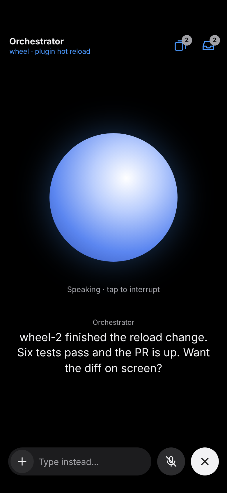
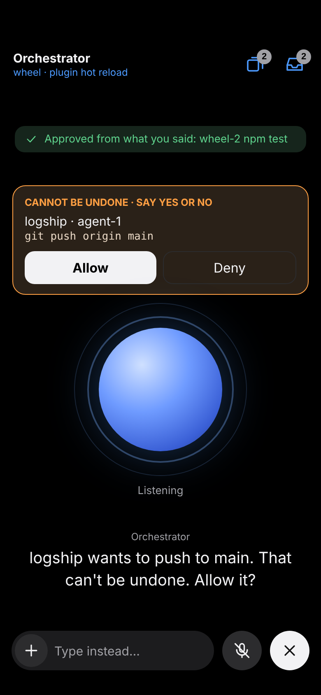
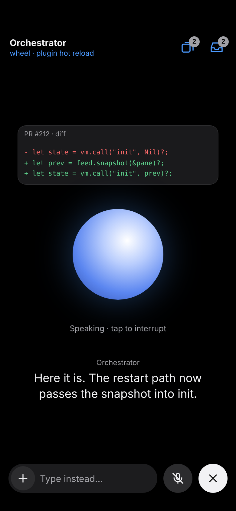

# Voice mode

Design from the 22 Nov 2026 session, written to be built on its own. It sits alongside the orchestrator redesign (`docs/orchestrator-redesign/index.md`, §8.9) and follows that doc's layout rules: one header row, the composer only on agent panes, badges, and the settings gear. Built so far: composer dictation (§5.8) and voice mode on the Mac (§5.9); the iPhone has dictation but not voice mode.

## 1. What it is

A full-screen, back-and-forth spoken conversation with **any agent pane**: the orchestrator, an agent in a space, or an agent opened from Agents mode. There is no in-chat voice bar. The voice button in an agent's composer opens voice mode, and the X closes it.

The orchestrator is the main user: you talk through what's in the queue, give instructions and approve things while away from the keyboard.

## 2. Decisions already made

- **Transcription runs on the device**, on both the phone and the Mac. Text goes over the wire to wheeld, never audio.
- **Not Apple's built-in speech recognition** (`SFSpeechRecognizer`). Use a model that's downloaded after install and cached. Check existing libraries before writing one; WhisperKit (Whisper on Core ML) and whisper.cpp are the obvious candidates.
- **Replies use a system voice.** No voice cloning.
- **One voice client at a time** across the phone and the Mac. Starting voice on one device ends it on the other.
- **iOS keeps running in the background** through an active audio session, with the screen locked (§5.6).
- **Voice is a part any agent view can add**, not something built only for the orchestrator. If it's cheaper, it can run in the client natively.
- **Approvals are inferred from speech.** The agent says what it approved, and only irreversible actions need a spoken yes.

## 3. The conversation model

- **It's the same chat.** What you say is sent as your message; every reply is written into the chat as well as spoken. Voice and text mix freely, and leaving voice mode leaves the full transcript behind.
- **In the orchestrator, topics apply unchanged** (orchestrator doc §4.2): "next", "back to X" and "triage" work by voice, and nothing from the queue is spoken unless you ask.
- **Turn-taking:** detection on the device decides when you've stopped speaking (a voice-activity detector, e.g. Silero VAD), then sends the transcript. Hold-to-talk is a setting for noisy places.
- **Interrupting:** tap the orb or start talking while the agent speaks. Speech stops at once, the unspoken rest of the reply is dropped from audio (it's still in the chat), and it listens.
- **Spoken replies stay short.** While the voice client holds the `voice` lease and names an agent (`agent_voice`), each of that agent's turns carries the voice line (`daemon/src/voice.md`) as hidden context: short spoken sentences, summarize rather than read out code, and put anything long on screen. Claude takes it through a `UserPromptSubmit` hook, pi through Wheel's extension adding it to each run's system prompt; Codex refuses (ADR-0055).
- **Showing things:** when the agent refers to a diff, pane or doc, it shows it above the orb with `wheel agent card`. Tapping it opens it full screen.

## 4. Approvals

| Request | What happens |
|---|---|
| Reversible, and what you said covers it | Approved. A one-line green report on screen, and spoken in one short sentence |
| Reversible, not covered | Spoken question: "wheel-2 wants to run npm test. OK?" |
| Cannot be undone (push, delete, deploy, server restart) | An orange card on screen plus a spoken question. It waits for a clear yes or no. Tapping Allow or Deny on the card also works |

What counts as irreversible reuses wheel's existing check (`wheel_proto::is_irreversible`). Which rule applies stays configurable per the orchestrator doc: surface every request, let the agent decide, or use hooks to force it to ask.

## 5. Screens

### 5.1 Listening

The header shows the agent and its context line: the topic for the orchestrator, space and harness for others. On the right are the panes icon (with a badge) and the queue (orchestrator only). In the middle, the orb and its state. At the bottom: + (attach), "Type instead…", mute and end.

### 5.2 Speaking

A live caption of the spoken reply, with "Speaking · tap to interrupt".

### 5.3 Approval by voice

A reversible approval reported in one line; an irreversible request as a card plus a spoken question.

### 5.4 Showing a pane

What the agent refers to appears above the orb, which shrinks to make room.

### 5.5 Panes during voice

Swipe left, or tap the panes icon: the panes come back full screen and voice shrinks to a floating pill (orb, caption, mute, end). Voice keeps listening and speaking. Tap the orb to return to full screen. Tapping or swiping on a pane hides the keyboard, as everywhere else.

### 5.6 Locked

A Live Activity on the lock screen and Dynamic Island shows the state (listening, speaking, thinking), the agent and its topic, with mute and end.

### 5.7 Any agent

A Spaces agent pane (W11482 in llama-broker) in voice mode. The layout is the same without the queue.

### Orb states
| State | Look |
|---|---|
| Listening | Blue, with rings that pulse with your volume |
| Thinking | Gray, slowly breathing |
| Speaking | Bright, moving with the output level |
| Muted | Dimmed; the mute button is lit |

## 5.8 Composer dictation (built)

The microphone in an agent's composer, on the Mac (GPUI, in the row under the draft, left of the round button) and the iPhone (left of send). Press it, speak, press again: the recording becomes text added to the draft, and the person sends it as typed text with `agent_send`. Parakeet TDT 0.6b v3 runs through FluidAudio on the device (`docs/voice-mode/stt-engines.md`); the code is WheelUI's `Dictation`, which the iPhone's composer and the Mac's bridge (`dictation` op and event) share. The first press with no model on the device shows what the download fetches (469 MB from `huggingface.co/FluidInference/parakeet-tdt-0.6b-v3-coreml`, into FluidAudio's cache) with Download and Cancel. Nothing in it talks to wheeld, so it works with wheeld out of reach until the send.

## 6. Where things run

| Part | Where |
|---|---|
| Microphone, voice detection, transcription | On the device (phone or Mac) |
| Text to speech | On the device, system voice |
| The conversation | The agent's own session in wheeld; voice sends text with `agent_send` and reads the transcript stream like any client |
| Lock to one active voice client | wheeld (a small generic lock per agent, or for the whole daemon) |
| Voice line while active | wheeld answers the Claude agent's `UserPromptSubmit` hook with it while the `voice` lease holder names that agent (`agent_voice`); it clears with the lease (ADR-0055) |
| Panes during voice | Client: voice is a layer over the normal agent view, so pane navigation is unchanged |

## 7. Settings

These sit under Settings in the orchestrator doc:
- **Voice:** the transcription model (download size, keep on device), the system voice and speed, hold-to-talk vs automatic turn-taking, and whether to speak replies.
- **Approvals by voice:** off / reversible only / all with a spoken yes for irreversible.

## 5.9 Voice mode on the Mac (built)

The round button at the right end of the composer's lower row is voice mode while the draft is empty and the agent idle, Send while there is a draft or a file, and Stop while the agent works; with a wheeld that lacks `lease_claim` or `agent_voice` the empty state is a dimmed Send. Voice mode covers the agent pane whose button opened it; the rest of the grid stays as it was.

- **Audio:** WheelUI's `Voice` (shared with a later iPhone build) through the bridge's `voice` op and event. One `AVAudioEngine` with voice processing on holds the microphone and plays the spoken reply, so its echo cancellation hears what it plays. Silero VAD v6 (1.1 MB from `huggingface.co/FluidInference/silero-vad-coreml`) decides when a turn ends; Parakeet transcribes it; the text goes with `agent_send`. When the agent's turn ends, its reply is spoken with the system voice, and the caption shows it. Speaking over the reply, or pressing the orb, stops the speech; the chat keeps the whole reply.
- **wheeld:** opening claims the `voice` lease, then names the agent with `agent_voice`; X or Esc clears both. Another client taking the lease closes voice mode here, and the composer says "Voice mode moved to another device."
- **Layer:** the pane's label and "space · harness" at the top with the panes button on the right (no badge: the Mac grid shows its panes); the orb and its state word in the middle; at the bottom +, "Type instead…", mute and X. The first start with a model missing names both downloads with a Download button.
- **Pill:** the panes button, "Type instead…" and a card's chip shrink the layer to a pill over the transcript's foot (orb, state, caption, mute, X), and pressing its orb brings the layer back. A card the agent shows during voice is a chip above the orb, which shrinks; pressing it shows the card in the transcript under the pill.
- **Ends with its pane:** closing the window, closing the pane, or showing another space in that window ends voice mode, since nothing on screen would say the microphone is open. A reply that arrives while the person is still speaking waits until their turn is sent.
- **Not yet:** hold-to-talk, the Voice settings of §7, approvals by voice (§4), and the iPhone's voice mode.

## 8. Open items

1. Measure battery on the phone over a 10-minute voice session.
2. Wheeld lock for one active voice client.
3. Live Activity and audio session background on iOS.
4. The part shared by every agent view: the orb, captions, the pill, and the approval card.

Design canvas: https://claude.ai/artifact/XfjmQGaLfjHkYHJ2338FcF (Mobile page, Voice mode row).
